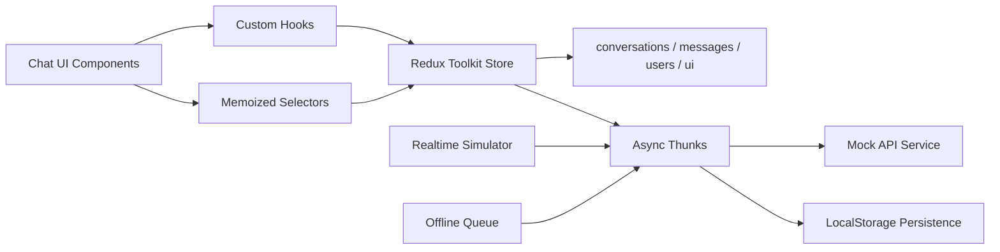

# Pulse Chat

Senior Frontend take-home: a modern, responsive chat app inspired by Slack / WhatsApp Web.

Built with **React**, **TypeScript**, **Redux Toolkit**, **Tailwind CSS**, **React Hook Form**, **Lucide**, and **Vitest**.

## Quick start

```bash
npm install
npm run dev
```

| Script | Description |
| --- | --- |
| `npm run dev` | Start Vite dev server |
| `npm run build` | Typecheck + production build |
| `npm run preview` | Preview production build |
| `npm test` | Run unit tests (Vitest) |
| `npm run test:watch` | Watch mode tests |

No backend is required. Mock API services simulate latency, delivery status, typing, presence, and inbound messages.

## Feature checklist

### Core
- Conversation sidebar with avatars, online status, last message, timestamps, unread badges
- Search + filters: All / Unread / Groups
- Chat window with send/receive, timestamps, delivery/read indicators
- Reply, edit, delete, copy, emoji reactions
- Messages grouped by date; typing indicators; auto-follow latest messages
- Group info panel with member online status + add/remove (mock)
- Responsive desktop / tablet / mobile layout
- Loading, empty, and error states
- In-conversation message search
- Keyboard shortcuts: Enter send, Shift+Enter newline, Esc cancel
- Light / dark themes

### Advanced challenges
- Virtualized message list (`react-virtuoso`) — designed for large histories
- Optimistic message sending
- Infinite scroll for older messages
- LocalStorage persistence for conversations, messages, theme, and offline queue
- Offline message queue + automatic flush when back online
- Debounced conversation / message search (300ms)
- Local file attachment preview
- Real-time simulation (typing, inbound messages, presence) via interval-based mock WebSocket layer

## Architecture

```
src/
  app/                  # Store, typed hooks
  features/chat/        # Feature module
    components/         # UI (Sidebar, ChatWindow, Group)
    hooks/              # Debounce, theme, offline queue
    slice/              # RTK slices + async thunks
    selectors.ts        # Memoized selectors
    types.ts            # Domain models
  services/             # Mock API, persistence, realtime (no UI)
  shared/               # Reusable UI + utils
  test/                 # Vitest setup
```

### Architecture diagram



### State management decisions

| Slice | Responsibility |
| --- | --- |
| `conversations` | Conversation list, unread counts, typing user IDs |
| `messages` | Per-conversation message arrays, pagination flags, offline queue |
| `users` | User directory + presence |
| `ui` | Active chat, filters, search, theme, reply/edit draft targets, online flag |

**Key choices**
- **Feature-based structure** keeps chat domain cohesive and scalable.
- **UI vs business logic**: components dispatch thunks / read selectors; network + persistence live under `services/`.
- **Optimistic sends**: pending thunk inserts a temporary message (`status: sending`); fulfilled replaces it by `clientId`; rejected marks `failed` and enqueues offline.
- **Persistence middleware** writes a capped snapshot after each action so refreshes restore context without bloating storage.
- **Virtuoso** keeps rendering cost flat for deep histories; older pages load via `startReached` + `hasMore`.
- **Realtime simulator** is intentionally not WebSocket transport — it mimics event timing while remaining fully frontend-testable.

## Assumptions & trade-offs

1. Single current user (`user-me`); no auth flow.
2. “Read” receipts are simulated after short delays, not multi-device sync.
3. Attachment uploads are local object-URL previews only (no server storage).
4. Persisted message history is capped (~500 per conversation) to protect LocalStorage quotas.
5. Realtime uses a timer-based simulator rather than a true WebSocket server.
6. Infinite history is generated by the mock API when a conversation is opened, so virtualization can be exercised without shipping a huge JSON dump.

## Testing

Focused unit coverage includes:
- Debounced search hook behavior
- Optimistic / offline message reducer transitions
- Conversation filter interactions

```bash
npm test
```

## License

Prepared as a take-home assignment submission.
